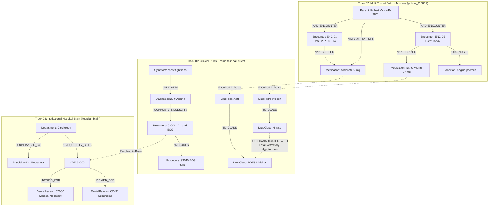

# OmniHealth Graph
### Intelligent Clinical Documentation & Revenue Optimization Assistant Powered by FalkorDB

[](https://www.falkordb.com/)
[](#track-01-agents-that-act-on-connected-data)
[](#track-02-agent-memory--coordination)
[](#track-03-company-brain)
[](LICENSE)

---

## 🎥 Working Demo Video Walkthrough
> **Official Submission Video:** 
> 🔗 **[Watch the 3-Minute End-to-End Walkthrough on YouTube / Loom](https://youtu.be/PLACEHOLDER)** *(Replace with your recording link)*
> 
> *A live, continuous demonstration of the speech-to-EHR agentic pipeline, FalkorDB Cypher provenance trails, cross-session contraindication interception, and institutional denial analytics.*

---

## 🏆 Hackathon Tracks Entered (All 3 Tracks)

OmniHealth Graph enters all three tracks of **Graph Hacks: Context for AI Agents Powered by FalkorDB** because FalkorDB is not merely a visualizer—it is the **load-bearing reasoning, memory, and governance layer** of the entire clinical pipeline:

| Track | Product Capability | FalkorDB Role |
| :--- | :--- | :--- |
| **Track 01: Agents That Act on Connected Data** | **Medical Necessity & Code Unbundling Proofs** | Coding & compliance agents execute multi-hop Cypher traversals (`Symptom ➔ Diagnosis ➔ Procedure`) to prove deterministic necessity for CPT reimbursement, returning literal `nodes(path)` pill trails and catching NCCI bundling violations (e.g. CPT 93000 vs 93010). |
| **Track 02: Agent Memory & Coordination** | **Cross-Session Patient Safety & Isolated Memory** | Multi-tenant isolated subgraphs (`patient_<id>`) preserve longitudinal encounters, diagnoses, and active medications. When a new drug is ordered, the clinical agent traverses past encounters against pharmacological contraindication rules (`Nitrate ➔ PDE5 Inhibitor`), preventing fatal refractory hypotension. |
| **Track 03: Company Brain** | **Institutional Hospital Brain & Revenue Optimization** | An enterprise `hospital_brain` graph connects clinical departments, supervising physicians, frequently billed CPT codes, and historical payer denial reasons (CARC codes CO-50, CO-97, CO-16), preempting claim denials before submission. |

---

## 🩺 Clinical Problem Statement: The Crisis in Clinical Documentation & Revenue Integrity

Clinicians spend **over 2 hours on administrative electronic health record (EHR) data entry for every 1 hour of direct patient care**. This chronic administrative burden leads to:
1. **Severe Clinician Burnout:** Doctors spend their evenings on "pajama time" charting notes.
2. **Medical Necessity Denials:** Insurers deny up to **15% of hospital claims** when documentation fails to prove that a diagnosed condition justified the ordered procedure (CARC CO-50).
3. **NCCI Bundling Clawbacks:** Billing component procedures alongside comprehensive services (e.g. billing ECG interpretation 93010 alongside full 12-lead ECG 93000) triggers automated claim rejections (CARC CO-97).
4. **Dangerous Cross-Visit Amnesia:** Stateless LLMs and vector stores cannot reliably recall that a patient was prescribed Sildenafil 7 months ago when a doctor prescribes Nitroglycerin today.
5. **Why Vector RAG Fails in Healthcare:** Vector search retrieves text that *sounds* semantically similar, but semantic proximity is **not a clinical proof**. Claim adjudicators require verifiable, auditable necessity paths, strict tenant isolation, and deterministic explainability.

OmniHealth Graph replaces vector stores entirely with **FalkorDB** as the high-performance graph reasoning engine.

---

## 🔄 End-to-End Clinical & Revenue Optimization Workflow

```
Doctor-Patient Conversation
          ↓
   Speech-to-Text
          ↓
Conversation Analysis & PII De-identification
          ↓
Clinical Information Extraction
          ↓
┌─────────────────────────┴─────────────────────────┐
↓                                                   ↓
Clinical Documentation Agent             Medical Coding & Compliance Agent
↓                                                   ↓
Structured SOAP Notes Generation         ICD-10-CM & CPT Code Recommendations
↓                                                   ↓
Cross-Session Contraindication Check     FalkorDB Deterministic Proof Paths (nodes(path))
↓                                                   ↓
Documentation Gap Detection              NCCI Bundling & Denial Risk Analysis
└─────────────────────────┬─────────────────────────┘
                          ↓
              Revenue Leakage Insights & Hospital Brain
                          ↓
              Human-in-the-Loop Validation
           (Doctor Acknowledges Alerts & Signs Off)
                          ↓
              FalkorDB Encounter Writeback
            (Encounter Committed to Patient Memory)
                          ↓
              EHR / Billing Release
```

---

## 🕸️ Visual Graph Data Model

The system operates across three interconnected graph families hosted within one FalkorDB instance:



---

## ⚡ Core Cypher Queries & Graph Traversals

### 1. Medical Necessity Multi-Hop Traversal (Track 01)
Proves that documented clinical symptoms justify the recommended billing code via a 3-node path, returning the literal `nodes(path)` rendered in the UI as a provenance pill trail:
```cypher
MATCH path = (s:Symptom)-[:INDICATES]->(d:Diagnosis)-[:SUPPORTS_NECESSITY]->(p:Procedure {code: $code})
WHERE s.name IN $symptoms
RETURN [n IN nodes(path) | coalesce(n.name, n.code)] AS trace_path, d.code AS icd, p.code AS cpt
ORDER BY d.code
LIMIT 1
```

### 2. NCCI-Style Code Unbundling Detection (Track 01)
Intercepts unbundled component codes (e.g. CPT 93010) billed alongside a comprehensive procedure (CPT 93000) before payer claim submission:
```cypher
MATCH path = (a:Procedure)-[:INCLUDES]->(b:Procedure)
WHERE a.code IN $cpt_codes AND b.code IN $cpt_codes
RETURN a.code AS comprehensive, b.code AS component, [n IN nodes(path) | n.code] AS trace_path
```

### 3. Cross-Session Patient Memory & Drug Contraindication Traversal (Track 02)
Traverses active prescriptions in tenant-isolated subgraph `patient_{patient_id}` against pharmacological class contraindications in `clinical_rules`:
```cypher
// Step A: Retrieve active patient medications from isolated patient memory
MATCH (p:Patient {id: $patient_id})-[:HAS_ACTIVE_MED]->(m:Medication)<-[:PRESCRIBED]-(e:Encounter)
RETURN m.name AS med_name, e.id AS encounter_id, e.date AS encounter_date

// Step B: Multi-hop drug-class contraindication path query in rules graph
MATCH path = (new:Drug {name: $new_drug})-[:IN_CLASS]->(:DrugClass)-[r:CONTRAINDICATED_WITH]-(:DrugClass)<-[:IN_CLASS]-(active:Drug)
WHERE active.name IN $active_med_names
RETURN active.name, r.severity, r.effect, [n IN nodes(path) | n.name] AS trace_path
```

### 4. Patient Encounter Memory Writeback (Track 02)
Idempotent writeback upon clinician sign-off that updates the longitudinal patient memory:
```cypher
MERGE (p:Patient {id: $pid}) SET p.name = coalesce($name, p.name)
MERGE (p)-[:HAD_ENCOUNTER]->(e:Encounter {id: $eid}) SET e.date = $date
MERGE (e)-[:DIAGNOSED]->(c:Condition {name: $condition})
MERGE (m:Medication {name: $medication})
MERGE (e)-[:PRESCRIBED]->(m)
MERGE (p)-[:HAS_ACTIVE_MED]->(m)
```

### 5. Institutional Hospital Brain Denial Hotspots Query (Track 03)
Surfaces department-level historical claim denial patterns (CARC codes) to alert the medical coder and provider at review time:
```cypher
MATCH path = (d:Department {name: $department})-[b:FREQUENTLY_BILLS]->(c:CPT)-[x:DENIED_FOR]->(r:DenialReason)
RETURN c.code AS cpt_code, c.name AS procedure_name, b.count AS billed_count, 
       r.code AS denial_code, r.name AS denial_reason, x.count AS denial_count,
       [n IN nodes(path) | coalesce(n.name, n.code)] AS trace_path
ORDER BY x.count DESC
```

---

## 🛠️ Technology Stack & Architecture

- **Graph Database:** [FalkorDB](https://www.falkordb.com/) (Ultra low-latency Redis-based graph engine with full Cypher support).
- **Backend Framework:** FastAPI (Python 3.10+ / 3.14 compatible), Uvicorn.
- **Orchestration:** LangGraph multi-agent cyclical workflow.
- **LLM Engine:** Google Gemini (`gemini-1.5-pro` via `langchain-google-genai`) with built-in zero-dependency offline simulator fallback.
- **Security & Privacy:** Fernet symmetric PHI encryption, JWT Bearer authentication, PBKDF2 password hashing.
- **Frontend App:** React 18, TypeScript, Vite, Tailwind CSS, Framer Motion, Lucide Icons.
- **Persistence:** MongoDB with automated in-memory embedded fallback if MongoDB daemon is absent.

---

## 🚀 Quickstart: Local Setup & Execution

### Prerequisites
- [Docker Desktop](https://www.docker.com/products/docker-desktop/) (for FalkorDB)
- Python 3.10+ and Node.js 18+

### Step 1: Start FalkorDB Container
Run the official FalkorDB Docker container exposing both the Redis graph port (6379) and FalkorDB Browser (3000):
```bash
docker run -d --name falkordb -p 6379:6379 -p 3000:3000 falkordb/falkordb:latest || docker start falkordb
```
- **FalkorDB Engine:** `localhost:6379`
- **FalkorDB Browser:** `http://localhost:3000`

---

### Step 2: Configure & Start Backend Server
```bash
# 1. Navigate to backend directory
cd backend

# 2. Generate environment secrets (random JWT & Fernet keys)
# Usage: python generate_env.py [OPTIONAL_GEMINI_API_KEY]
python generate_env.py

# 3. Create and activate virtual environment
python -m venv .venv
# On Windows:
.venv\Scripts\activate
# On Linux/macOS:
# source .venv/bin/activate

# 4. Install backend dependencies
pip install -r requirements.txt

# 5. Start Uvicorn backend server
uvicorn app.main:app --port 8000
```
- **Backend API:** `http://localhost:8000`
- **Swagger Docs:** `http://localhost:8000/docs`
- **Health Check:** `http://localhost:8000/health` (Reports graph engine, seeded graphs, and database status).

---

### Step 3: Start Frontend Dev Server
In a new terminal window:
```bash
cd frontend
npm install
npm run dev
```
- **Frontend Application:** `http://localhost:5173`

---

## 🧪 Testing the Live Demo Case (Robert Vance)

1. Open **`http://localhost:5173`** and sign in:
   - **Username:** `doctor@hospital.com`
   - **Password:** `doctor123`
2. Go to **Sessions** → Click **New Session**:
   - **Patient Name:** `Robert Vance`
   - **DOB:** `1960-05-12`
   - *(The system automatically binds Robert Vance to tenant graph `patient_P-9801`)*.
3. On the consultation recording screen, click **Load demo case (Robert Vance)** and click **Optimize & Generate EHR**:
   ```
   Doctor: Hello Mr. Vance, what brings you in today?
   Patient: For two weeks my chest feels heavy and tight when I climb stairs. It goes away when I rest.
   Doctor: This sounds like angina. I will order a 12-lead ECG and a blood glucose, and prescribe nitroglycerin 0.4 mg sublingual as needed.
   ```
4. **Inspect the Clinical Provenance & Flags:**
   - **Billing Codes Tab:** See the FalkorDB provenance pill trail: `chest tightness ➔ I20.9 ➔ 93000`.
   - **Unbundling Warning:** Notice CPT `93010` flagged with an amber warning because `93000` already includes `93010`.
   - **Contraindication Alert:** See the red contraindication alert in the Plan: Active **Sildenafil** from encounter `ENC-01` conflicts with prescribed **Nitroglycerin** (fatal hypotension).
   - **Hospital Brain Card:** See Cardiology department claim denial insights (CO-50 and CO-97 trends).
5. **Human-in-the-Loop Sign-Off:**
   - Notice the **Approve** button is disabled until the doctor acknowledges the drug interaction.
   - Check the acknowledgement checkbox and click **Approve EHR & Release Codes**.
   - Open **`http://localhost:3000`** in FalkorDB Browser, select `patient_P-9801`, and run `MATCH (n) RETURN n` to see the new encounter committed to memory.

---

## 🌐 Production & Cloud Deployment Notes

- **Frontend (Vercel):** The `frontend/` directory is 100% Vercel-ready with [frontend/vercel.json](file:///c:/Users/Lenovo/Desktop/Healthcare_Platform/healthcare_platform/frontend/vercel.json) for SPA routing. Set environment variable `VITE_API_BASE=https://<your-backend-domain>/api`.
- **Backend (Render / Railway / Fly.io / Cloud VM):** Set `FALKORDB_HOST`, `FALKORDB_PORT`, `FALKORDB_PASSWORD`, `JWT_SECRET_KEY`, `FERNET_KEY`, and `GEMINI_API_KEY`.
- **FalkorDB Cloud:** Deploy on FalkorDB Cloud and point `FALKORDB_HOST` and credentials in `backend/.env`.

---

## 🔒 Security, Compliance & Human-in-the-Loop Governance
- **Zero Hallucination Proof Paths:** CPT and ICD-10 suggestions are strictly anchored to deterministic FalkorDB Cypher paths.
- **HIPAA Security Rule Architecture:** PHI transcripts are encrypted at rest using Fernet symmetric 256-bit keys before database storage.
- **Enforced Clinician Oversight:** AI agents never autonomously finalize clinical records. Clinicians retain full editorial control and must explicitly acknowledge contraindications to release claims.
- **Comprehensive Audit Trail:** Every session creation, agent optimization, and sign-off generates an immutable audit log entry.
